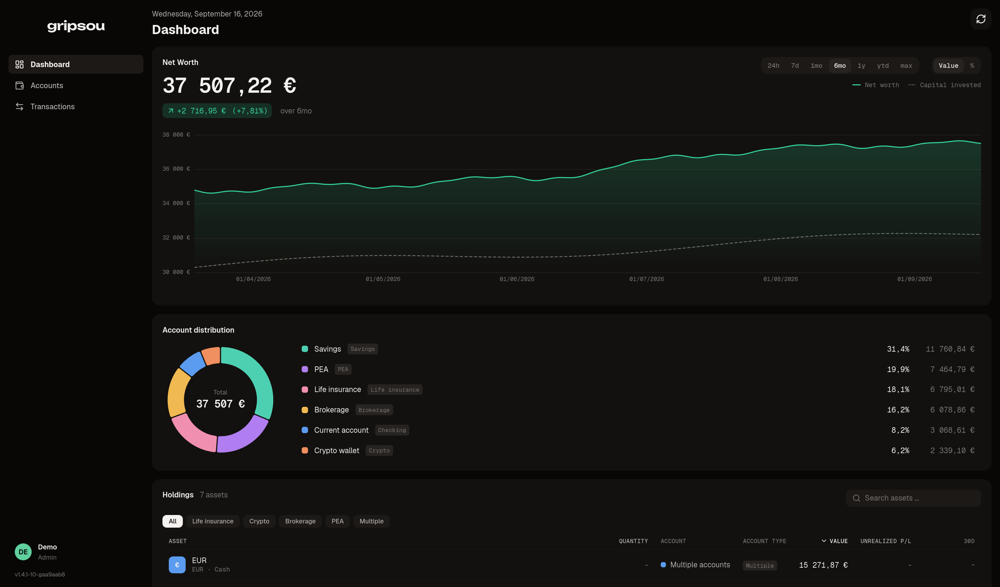

# gripsou

Self-hosted personal finance dashboard. Connect bank and broker providers,
sync transactions and holdings, and see net worth and its distribution over time.



## Inspirations

This project is the result of multiple iterations. I've built this "same" personal finance project before, learned from those attempts, and started from scratch again to build it right.

The initial inspiration came from [Finary](https://finary.com/). Later, I discovered [Zoeille/picsou-finance](https://github.com/Zoeille/picsou-finance), which gave me a fresh wave of inspiration (and heavily influenced the project's name, `gripsou`).

The current interface and workflow are a mix of my own ideas, concepts from Picsou, and Finary.

## Develop

Prerequisites: Rust (stable), [bun](https://bun.sh) (the version `frontend/package.json` pins), Docker.

```sh
# 1. Start Postgres
docker compose -f docker/docker-compose.yml up -d postgres

# 2. Backend (serves API on :8080, applies migrations on startup)
cp .env.example .env          # then fill in the database address and secrets
cd backend
cargo run

# 3. Frontend (dev server on :5173, proxies /api to :8080)
cd frontend
bun install
bun run dev
```

`./ci.sh` runs the same checks as CI (`./ci.sh backend` or `./ci.sh frontend` for one half). Its backend tests start a throwaway Postgres container.

## Run the whole stack

```sh
scripts/build-image.sh
docker compose -f docker/docker-compose.yml up -d
```

The backend binary serves both the built SPA and the JSON API, with Postgres alongside. It publishes no port: it joins the external Docker network `web` (`docker network create web`), where a reverse proxy forwards to `backend:8080`. `scripts/build-image.sh` stamps the image with `git describe` of your checkout, the version shown in the app; a plain `docker compose build` labels it `dev`.

### First start

On an empty database, the backend prints a setup code to its terminal just before it starts listening:

```sh
docker compose -f docker/docker-compose.yml logs backend
```

Open gripsou in a browser: the sign-in page sends you to the setup page, which asks for that code and creates the first account, as administrator. Each start prints a new code, so use the newest one in the log. Once any account exists, the setup page is closed for good. The code is never saved in the app's own log.

## Locked out of two-factor

If you lose both your authenticator app and your backup codes, run this on the server:

```sh
docker compose -f docker/docker-compose.yml exec backend gripsou reset-2fa you@example.com
```

## Powens

Enter the Powens keys in Settings → Server → API keys. In the Powens console, allow `<PUBLIC_URL>/connections/callback` as a redirect address (for example `http://localhost:5173/connections/callback` in development).

## Powens webhooks (optional)

For real-time sync of Powens connections (instead of polling):

1. Expose `https://<host>/api/webhooks/powens` publicly.
2. In the Powens console, register a webhook for `CONNECTION_SYNCED` pointing to that URL.
3. Register an HMAC auth provider on the **Powens** API (not gripsou), using your Powens configuration token:
   ```sh
   curl -X POST https://<your-domain>.biapi.pro/webhooks/auth \
     -H "Authorization: Bearer <powens-configuration-token>" \
     -H "Content-Type: application/json" \
     -d '{ "type": "hmac_signature", "name": "gripsou" }'
   ```
   Save the returned `config.secret_key` (shown only once).
4. In the Powens console, associate the auth provider with your webhook.
5. Enter `<secret_key>` as the Powens webhook secret in Settings → Server → API keys.

When no webhook secret is saved, sync falls back to direct full-fetch and the daily poll schedule.

## Changelog

See [Releases](https://github.com/TagCopperLight/gripsou/releases).
